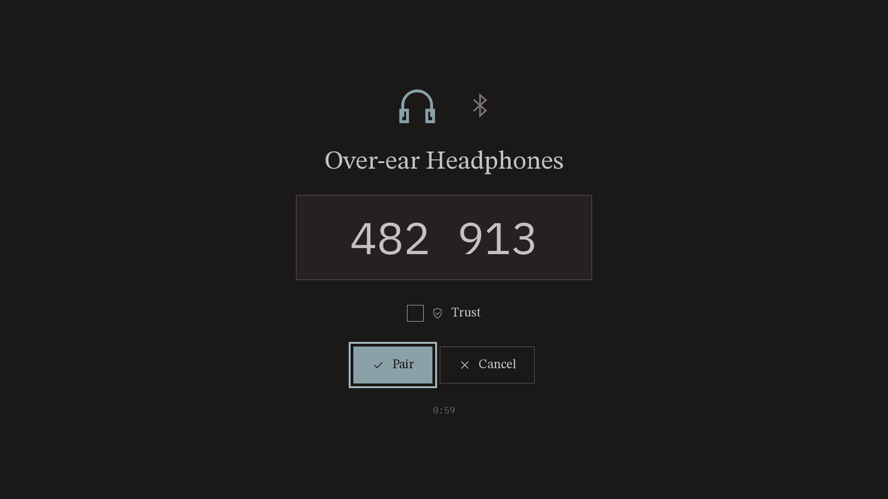
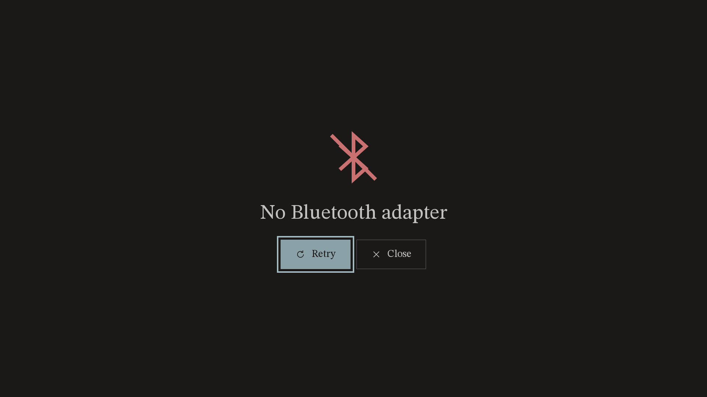
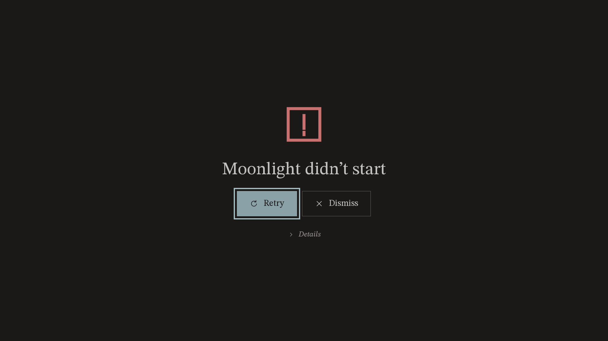

# Home Theatre Launcher

A minimal, controller-friendly TV launcher for NixOS. It is configured
entirely through Nix: one persistent **labwc** compositor, a fullscreen
**Qt 6 / QML** interface, and **systemd** supervising every app. You can
launch any application you configure; Moonlight and Waydroid are only
ready-made examples. The launcher also includes a full Bluetooth menu, a
read-only internet indicator and a clock.


The design is in `docs/design/` (rendered from the original PDF) and
follows flatwork-ui: flat, dark and square. The one deliberate difference is
the controller button prompts, which use the real Xbox / PS5 glyphs from
Kenney *Input Prompts* (CC0, `launcher/assets/glyphs/`).

## Screenshots

Rendered by the app itself (`--screenshot`, demo data) at 1920×1080.

| | |
|---|---|
|  |  |
| **Home**: app tiles with Bluetooth, internet and clock | **Starting…** shown above the app until its window is ready |
|  |  |
| **Bluetooth** menu with Xbox button prompts | Prompts follow the last-used controller (PS5) |
|  |  |
| **Pairing**: confirm the passkey; trust is opt-in | No Bluetooth adapter |
|  |  |
| Readable start error with Retry / Dismiss | Cleanup incomplete: Stop again forces it and launches stay blocked |

## Use it from a NixOS flake

```nix
# flake.nix of the machine
{
  inputs = {
    nixpkgs.url = "github:NixOS/nixpkgs/nixos-26.05";
    home-theatre-launcher.url = "github:jurrebuunk/home-theatre-launcher";
    home-theatre-launcher.inputs.nixpkgs.follows = "nixpkgs";
  };
  outputs = { nixpkgs, home-theatre-launcher, ... }: {
    nixosConfigurations.tv = nixpkgs.lib.nixosSystem {
      system = "x86_64-linux";
      specialArgs = { inherit home-theatre-launcher; };
      modules = [ home-theatre-launcher.nixosModules.default ./configuration.nix ];
    };
  };
}
```

```nix
# configuration.nix
{ pkgs, home-theatre-launcher, ... }:
{
  services.home-theatre-launcher = {
    enable = true;
    user = "theatre";
    apps = [
      (home-theatre-launcher.lib.apps.moonlight { inherit pkgs; })
      (home-theatre-launcher.lib.apps.waydroid { inherit pkgs; })
      # any other application:
      {
        id = "kodi";
        label = "Kodi";
        icon = ./icons/kodi.svg;          # SVG using currentColor, or PNG
        command = [ "${pkgs.kodi-wayland}/bin/kodi" ];
        ready.window.appId = "kodi";
      }
    ];
    appearance = {
      uiScale = 1.25;                     # bigger for a far couch
      tile = { width = 480; height = 360; };
    };
    behavior.internet = {
      interface = "ens18";
      url = "https://example.net/generate_204";
      expectStatus = 204;
    };
  };
  virtualisation.waydroid.enable = true;  # only needed for the waydroid preset
}
```

To add apps or change the layout or style, edit the Nix config and rebuild.
You never need to change the application source. The module turns the
options into a versioned, read-only JSON file
(`/etc/home-theatre-launcher/config.json`). The app checks that file again
at build time (`--check-config`), so an invalid setup fails the build
instead of failing on the TV.

### What the module sets up

- The `user` account (no password; groups `input`, `video`, `render`, `audio`).
- greetd autologin into a single persistent labwc, which restarts if it
  crashes. labwc runs with no keybindings, no menus and no window
  decorations. Set `session.enable = false` to use your own session.
- The `home-theatre-launcher` systemd user service (`Restart=always`).
- A polkit rule that lets the user start and stop **only** the system units
  that apps declare in `systemUnits`. No sudo.
- BlueZ, PipeWire with WirePlumber (Bluetooth audio), fonts, and graphics.

### App options

Each entry in `apps` accepts these fields:

| option | meaning |
|---|---|
| `id`, `label`, `description`, `icon` | identity; `icon` is a path or `builtin:stream` / `builtin:tv` |
| `command`, `environment`, `workingDirectory` | argv executed directly (no shell) in a transient unit `htl-app-<id>.service` |
| `ready.window.appId` / `appIdRegex` / `titleRegex` / `any` | ready when a matching Wayland window is mapped |
| `ready.dbusName` | ready when this session-bus name appears |
| `exitWhen.unitExit` / `windowClosed` / `dbusNameLost` | what counts as the app having ended |
| `systemUnits` | system units started before the app and stopped (and verified stopped) after it |
| `stopCommand` | command run before stopping the app unit (e.g. `waydroid session stop`) |
| `timeouts.start` / `timeouts.stop` | bounded start and stop; stopping escalates to SIGKILL for the whole cgroup |
| `hooks.preStart` / `hooks.postStop` / `hooks.timeout` | optional argv hooks |

`appearance` exposes every colour, font and size token from the design. All
sizes are in px at 1920×1080 and are multiplied by `uiScale`. `behavior`
covers input mappings, Bluetooth, the internet check, the clock and the
compositor. See `nix/module.nix` for every option and its default.

## How it works

- **Lifecycle:** `launcher → launching → running → closing → launcher`, plus
  error states. Only one app runs at a time, and repeated activation is
  ignored. "Ready" means the configured window or bus name has appeared, not
  just that the process started. Exiting, crashing, or holding **Home**
  returns to the launcher.
- **Stopping:** the launcher runs the stop command, stops the app unit
  (systemd kills the whole cgroup), stops the app's system units, and then
  checks that all of them are gone. If something is still running after the
  stop budget, it shows *"… is still closing"* with **Stop again** (SIGKILL)
  and blocks further launches until cleanup succeeds.
- **Launcher restarts:** if the launcher process restarts, it adopts a
  still-running app. When nothing is running, it stops any app system units
  that were left active, so no Android container stays behind the home
  screen.
- **On top of apps:** the launcher is a layer-shell overlay, so
  *Starting…* and *Closing…* stay above the app. It unmaps while an app runs.
- **Input:** the launcher reads controllers through evdev (read-only, never
  grabbed). Holding Home works inside apps, controllers can navigate the
  launcher, and the button prompts follow the last-used device (Xbox,
  PlayStation, keyboard or remote).
- **Bluetooth:** uses BlueZ over D-Bus with its own pairing agent. It
  supports adapter selection, power, scanning with a timeout, pair (confirm
  passkey, display code, or enter PIN), connect/disconnect, trust/untrust and
  forget. Trust is only granted through the explicit checkbox.
- **Internet:** the indicator checks Ethernet carrier, then the default
  route, then DNS, then an HTTPS request with an expected status. The checks
  are timer driven and never block the UI or app launches.
- **Control API:** `nl.jurrebuunk.HomeTheatre1` on the session bus provides
  `Launch(s)`, `Home()`, `OpenBluetooth()` and the `State` property. The VM
  test uses it, and it can also back a compositor keybinding.

## Development

```sh
nix develop                      # toolchain
cmake -S launcher -B launcher/build -G Ninja -DWLR_PROTOCOLS_DIR=$(nix eval --raw nixpkgs#wlr-protocols)/share/wlr-protocols
ninja -C launcher/build && (cd launcher/build && ctest)

nix run .#demo                   # windowed demo: fake apps, Bluetooth and network
./launcher/build/home-theatre-launcher --screenshot bluetooth:/tmp/bt.png [--glyphs playstation]
nix flake check                  # package + unit tests + NixOS VM integration test
```

Screenshot views: `home`, `starting`, `closing`, `error-start`, `error-stop`,
`bluetooth`, `pairing`, `bt-no-adapter`. The README images in
`docs/screenshots/` are made this way (fonts via `FONTCONFIG_FILE` with STIX Two
and IBM Plex Mono).

## Verify on the real machine

These can only be confirmed with real hardware:

- Moonlight's Wayland app_id (`com.moonlight_stream.Moonlight`).
- How Waydroid's full UI behaves with the preset (session bus name
  `id.waydro.Session`). Check that `waydroid status` shows the container
  stopped after returning home.
- Controller Guide-button codes over Bluetooth. `BTN_MODE` and
  `KEY_HOMEPAGE` are both mapped by default; Xbox controllers may need
  `hardware.xpadneo`.

## Third-party assets

Controller glyphs: Kenney *Input Prompts*, CC0 (`launcher/assets/glyphs/LICENSE-kenney.txt`).
