# Home Theatre Launcher

A minimal, controller-friendly TV launcher for NixOS. It is configured
entirely through Nix: one persistent **labwc** compositor, a fullscreen
**Qt 6 / QML** interface, and **systemd** supervising every app. You can
launch any application you configure; Moonlight and Waydroid are only
ready-made examples. Moonlight gets a library of its own: the apps of your
paired PCs as box art, with Wake-on-LAN, host discovery and pairing, and an
in-app menu that knows it is a stream. The launcher also includes a full Bluetooth menu, a
Network screen (Ethernet details and Wi-Fi with an on-screen keyboard), an
in-app menu over running apps, sound output and volume control,
notifications that appear over everything, an idle screen with a large
clock, an internet indicator and a clock.

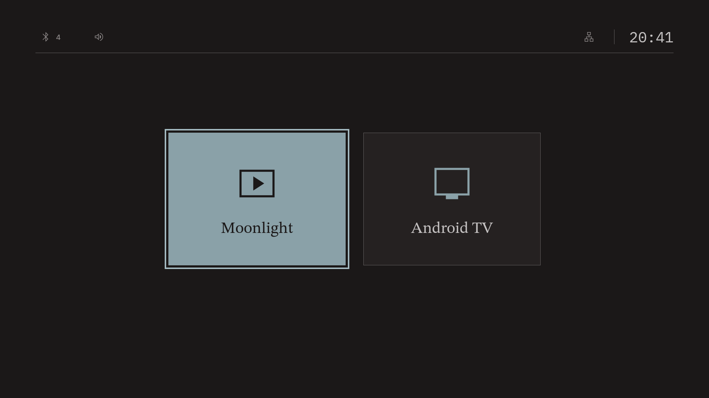
*Home: app tiles with Bluetooth, sound, network and the clock.*

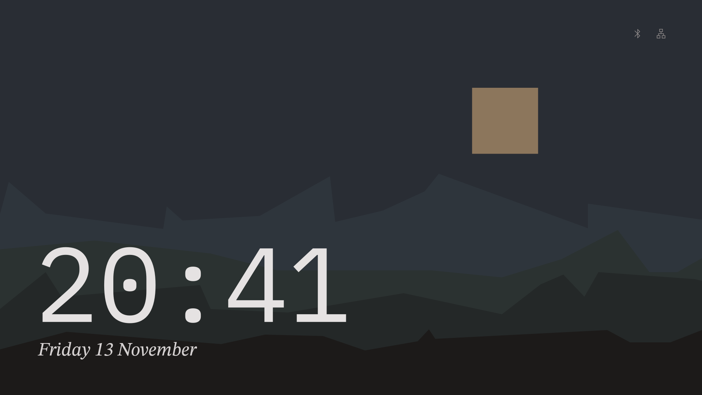
*Idle screen: a large clock over a colour, picture, slideshow or video.*

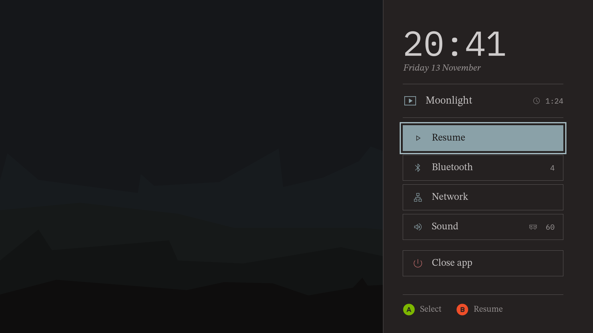
*In-app menu over a running app, which keeps running dimmed behind it.*

The design is in `docs/design/` (rendered from the original PDF) and
follows flatwork-ui: flat, dark and square. The icons come from established
packs rather than the design's line drawings:

- **Interface and app icons:** Google [Material Symbols](https://fonts.google.com/icons),
  *Sharp* style at weight 300, with square corners and thin strokes to match
  the design.
- **Controller button prompts:** the real Xbox / PS5 glyphs from Kenney
  *Input Prompts*.

## More screenshots

Rendered by the app itself (`--screenshot`, demo data) at 1920×1080.

| | |
|---|---|
| 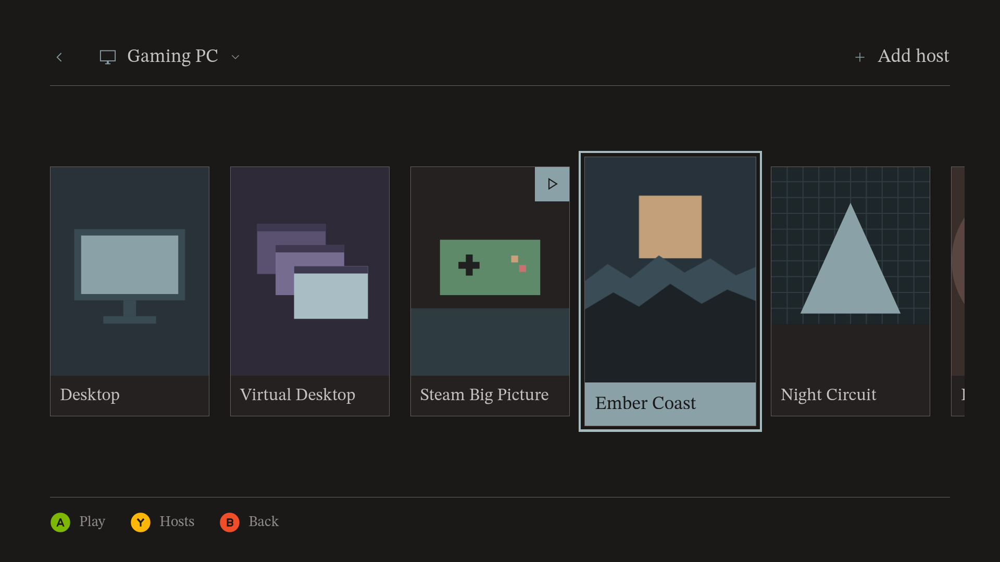 | 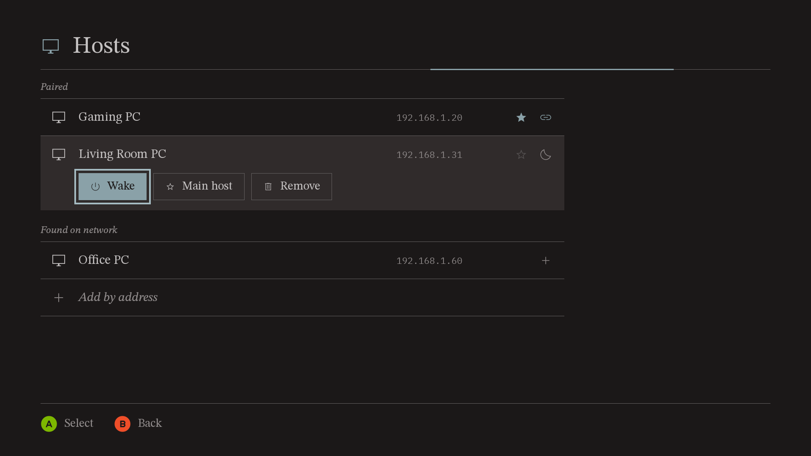 |
| **Moonlight**: the host's apps as box art; ▶ marks what runs on the PC | **Hosts**: wake, choose the main host, remove; pair found PCs or add one by address |
| 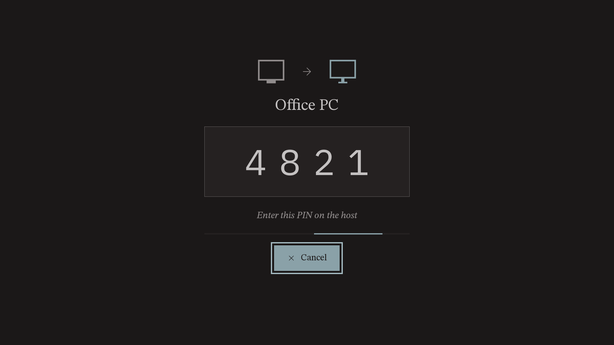 |  |
| **Pairing**: enter the PIN on the PC | In a stream the menu offers **Stop playing** (quits the game on the PC) or **Disconnect** |
|  | 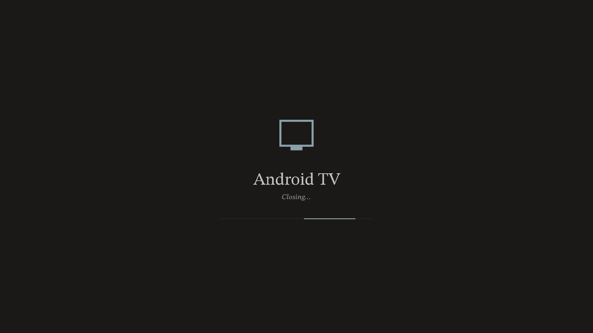 |
| **Starting…** shown above the app until its window is ready | **Closing…** while the app and its services stop |
|  |  |
| **Bluetooth** menu with Xbox button prompts | Prompts follow the last-used controller (PS5) |
|  |  |
| **Pairing**: confirm the passkey; trust is opt-in | No Bluetooth adapter |
|  |  |
| Readable start error with Retry / Dismiss | Cleanup incomplete: Stop again forces it and launches stay blocked |
| 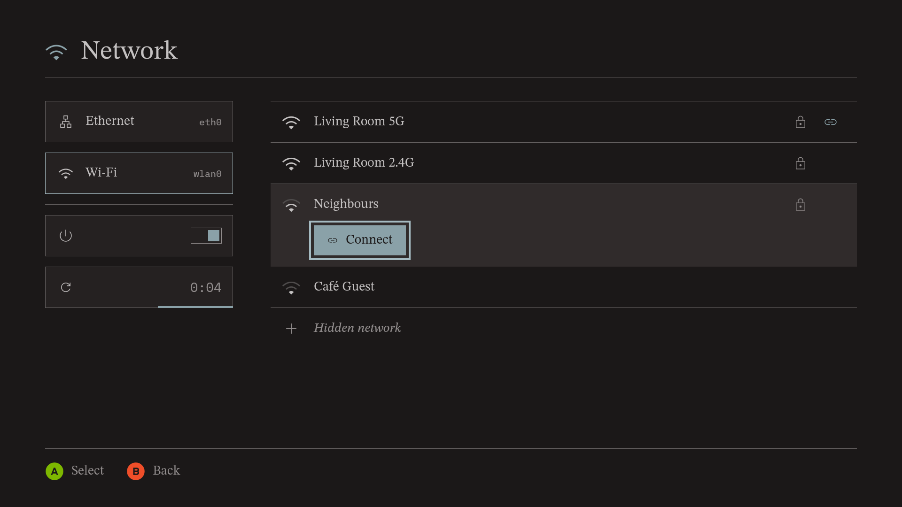 |  |
| **Network → Wi-Fi**: power, timed scan, networks with signal / lock / connected | Password entry with the on-screen keyboard (A type, X delete, Menu connect) |
| 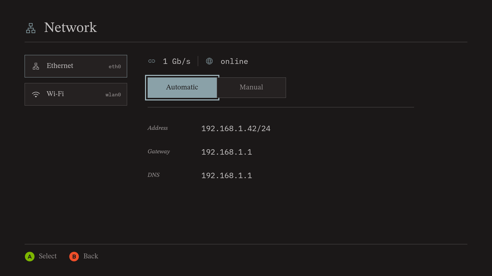 | 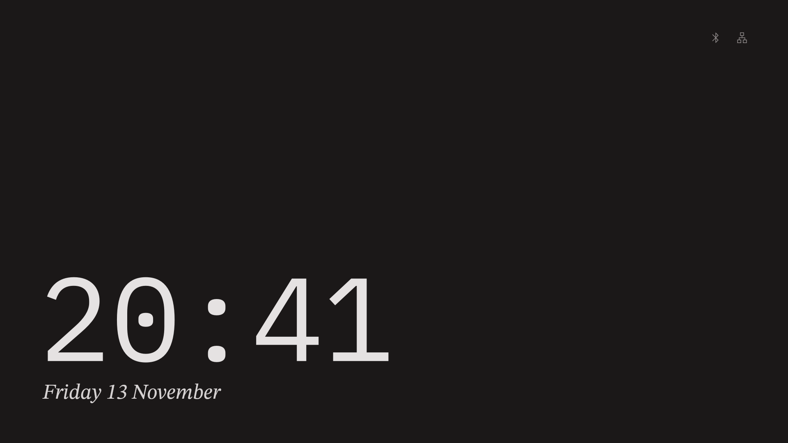 |
| **Network → Ethernet**: speed, reachability, Automatic / Manual IPv4 | **Idle screen** on a plain colour |
| 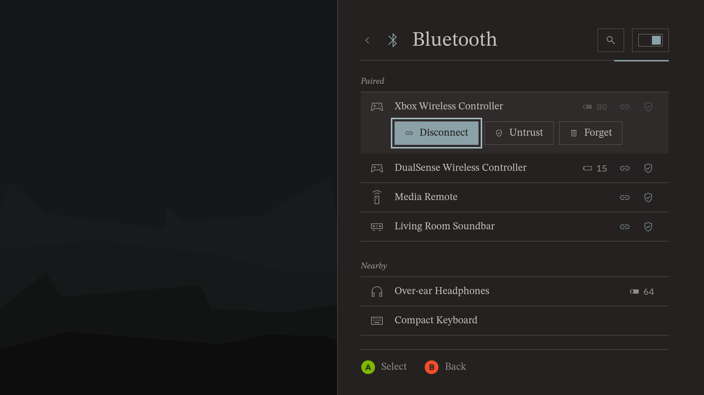 | 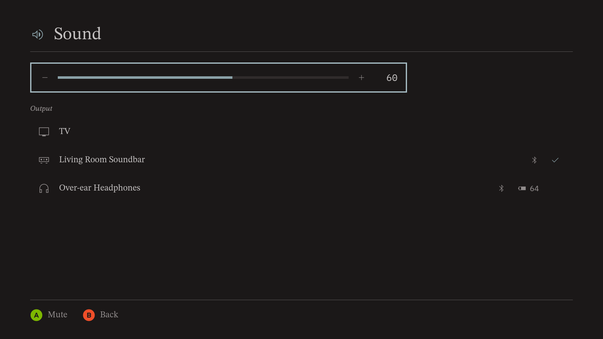 |
| Bluetooth from inside an app | **Sound** screen from the home status row |
| 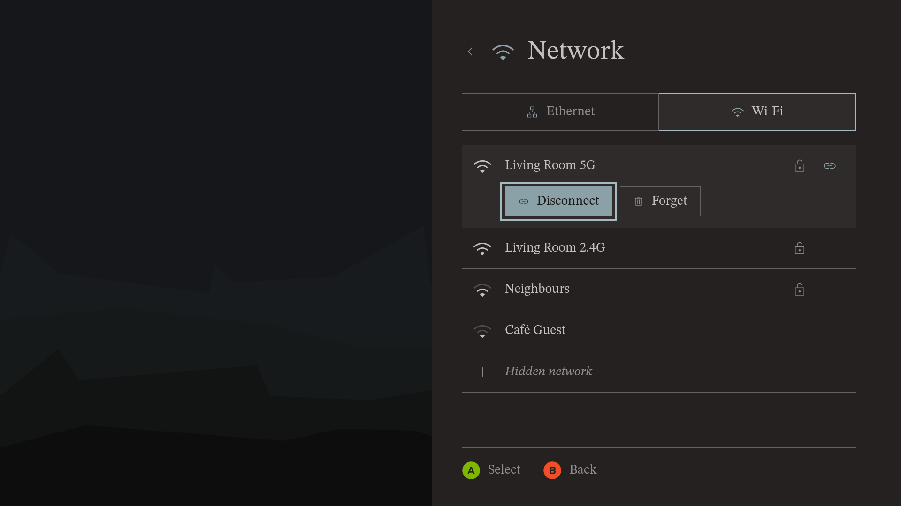 | 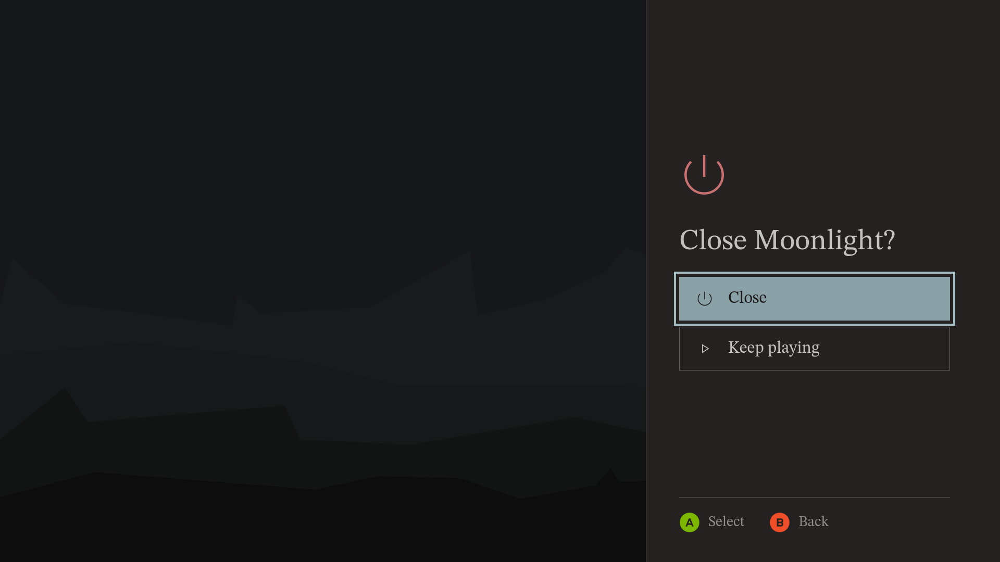 |
| Network from inside an app | Close confirmation |
| 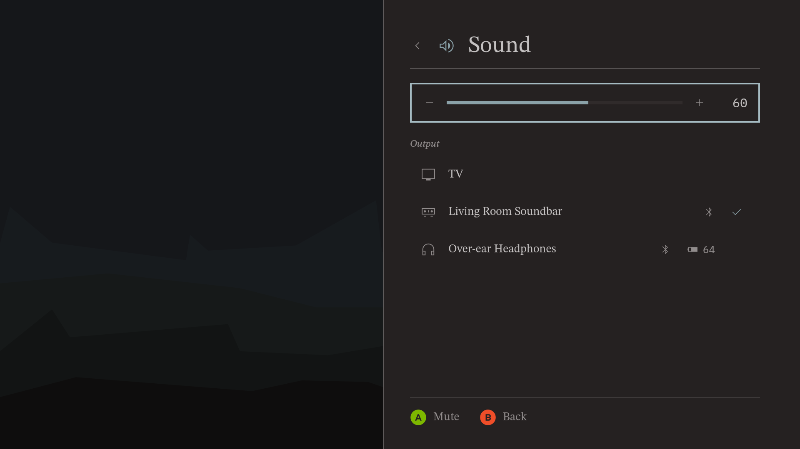 | 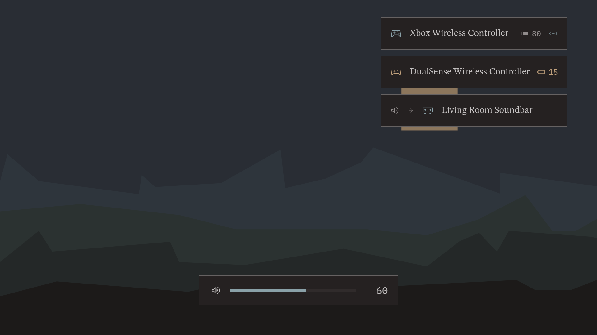 |
| **Sound**: volume and output (TV, soundbar, Bluetooth headphones) | **Notifications** and the volume indicator over an app, never dimmed |

## Use it from a NixOS flake

```nix
# flake.nix of the machine
{
  inputs = {
    nixpkgs.url = "github:NixOS/nixpkgs/nixos-26.05";
    home-theatre-launcher.url = "github:jurrebuunk/home-theatre-launcher";
    home-theatre-launcher.inputs.nixpkgs.follows = "nixpkgs";
  };
  outputs = { nixpkgs, home-theatre-launcher, ... }: {
    nixosConfigurations.tv = nixpkgs.lib.nixosSystem {
      system = "x86_64-linux";
      specialArgs = { inherit home-theatre-launcher; };
      modules = [ home-theatre-launcher.nixosModules.default ./configuration.nix ];
    };
  };
}
```

```nix
# configuration.nix
{ pkgs, home-theatre-launcher, ... }:
{
  services.home-theatre-launcher = {
    enable = true;
    user = "theatre";
    apps = [
      (home-theatre-launcher.lib.apps.moonlight { inherit pkgs; })
      (home-theatre-launcher.lib.apps.waydroid { inherit pkgs; })
      # any other application:
      {
        id = "kodi";
        label = "Kodi";
        icon = "material:live_tv";       # any Material Symbol, builtin:<name>, or a path
        command = [ "${pkgs.kodi-wayland}/bin/kodi" ];
        ready.window.appId = "kodi";
      }
    ];
    appearance = {
      uiScale = 1.25;                     # bigger for a far couch
      tile = { width = 480; height = 360; };
    };
    behavior.internet = {
      interface = "ens18";
      url = "https://example.net/generate_204";
      expectStatus = 204;
    };
    behavior.idle = {
      timeout = 600;                      # seconds without input
      background = {
        type = "slideshow";               # color | image | slideshow | video
        directory = "/srv/photos";        # re-read every time the idle screen starts
        interval = 30;
        fadeMs = 1500;
      };
    };
    behavior.network.networkmanager = true; # editable Wi-Fi / Ethernet (see below)
  };
  virtualisation.waydroid.enable = true;  # only needed for the waydroid preset
}
```

To add apps or change the layout or style, edit the Nix config and rebuild.
You never need to change the application source. The module turns the
options into a versioned, read-only JSON file
(`/etc/home-theatre-launcher/config.json`). The app checks that file again
at build time (`--check-config`), so an invalid setup fails the build
instead of failing on the TV.

### What the module sets up

- The `user` account (no password; groups `input`, `video`, `render`, `audio`).
- greetd autologin into a single persistent labwc, which restarts if it
  crashes. labwc runs with no keybindings, no menus and no window
  decorations. Set `session.enable = false` to use your own session.
- The `home-theatre-launcher` systemd user service (`Restart=always`).
- A polkit rule that lets the user start and stop **only** the system units
  that apps declare in `systemUnits`. No sudo.
- BlueZ, PipeWire with WirePlumber (Bluetooth audio), fonts, and graphics.

### Idle screen

After `behavior.idle.timeout` seconds without input on the launcher (never
while an app runs), a large clock and date appear over the background. Any
button, key or mouse movement wakes it; that first press is swallowed so it
never also launches something.

| `behavior.idle.background.type` | uses |
|---|---|
| `color` (default) | `color` (default: the page background) |
| `image` | `image`: a path, or `builtin:mountains` (the landscape from the design) |
| `slideshow` | `images` and/or `directory`, `interval`, `fadeMs` (cross-fade), `shuffle` |
| `video` | `video` (path or URL, looped), `muted` |

`fill` (`cover` / `contain`) and `dim` (0–1, darkens pictures behind the
clock) apply to pictures and video. Set `behavior.idle.enable = false` to turn
it off. The date line uses `behavior.clock.dateFormat` and `locale`.

### In-app menu

While an app runs, a short press of Guide / PS (or `KEY_HOMEPAGE` on a
remote) opens a side panel over it: clock, the app and how long it has run,
**Resume**, **Bluetooth**, **Network** and **Close app** (with a
confirmation). The app keeps running and moving behind a dim layer. Holding
the button still returns straight home. The menu never opens on the launcher
itself.

```nix
behavior.overlay = {
  gamepadCodes = [ "BTN_MODE" "BTN_SELECT+BTN_START" ]; # buttons or combos
  keyboardCodes = [ "KEY_HOMEPAGE" "KEY_LEFTCTRL+KEY_M" ];
  dim = 0.5;
  grabControllers = true; # the app doesn't see button presses meant for the menu
};
```

Combos fire when they are released, so the app never keeps a stuck button.
`ToggleOverlay()` on the control API can back a compositor keybinding too.

### Moonlight

An app with `type = "moonlight"` (the `lib.apps.moonlight` preset sets it)
opens a library instead of starting moonlight-qt's own interface:

- **Library:** the apps of the selected host as box art. The app running on
  the PC carries a ▶ badge. **A** plays it: the stream starts as
  `moonlight stream <host> <app> <streamArguments>` and is supervised like
  any app. If another app runs on the PC, the launcher asks to quit it first.
  The host name at the top switches between paired hosts; **Y** opens Hosts.
- **Hosts:** paired PCs with their address, the main host (★, opened first)
  and whether they are online (🔗) or asleep (☾). Expand one for **Wake**
  (Wake-on-LAN) or **Open**, **Main host** and **Remove**. PCs announcing
  themselves on the network (mDNS through Avahi) are listed under *Found on
  network*; **Add by address** takes an IP address or host name.
- **Pairing:** shows a PIN to enter on the PC (Sunshine's web UI or GeForce
  Experience) while moonlight-qt pairs in the background.
- **In-app menu during a stream:** shows the game and the PC and offers
  **Stop playing**, which ends the stream *and* quits the game on the PC, or
  **Disconnect**, which leaves the game running there to resume later.

Hosts are kept in moonlight-qt's own settings, so its regular interface sees
the same PCs. Status, app lists and box art come directly from the host's
GameStream / Sunshine API with moonlight's client certificate, and the host
certificate saved at pairing is pinned.

```nix
apps = [
  ((home-theatre-launcher.lib.apps.moonlight { inherit pkgs; }) // {
    streamArguments = [ "--resolution" "1920x1080" "--fps" "60" ];
  })
];
behavior.moonlight = {
  discovery = true;    # enables Avahi (mDNS) to find hosts
  refreshSeconds = 5;  # host status while the library is open
};
```

### Sound

The speaker icon in the status row (and **Sound** in the in-app menu) shows
the volume of the current output and every output PipeWire offers: the TV
over HDMI, a soundbar, Bluetooth headphones (with their battery). Selecting
one makes it the default; playing audio follows it. Remote / keyboard volume
keys work everywhere, also inside apps, and show a volume bar at the bottom.

```nix
behavior.sound = {
  labels = { "alsa_output.pci-0000_00_1f.3.hdmi-stereo" = "TV"; }; # HDMI is "TV" by default
  hidden = [ "loopback" ];
  step = 5;
  maxVolume = 100;
};
```

### Notifications

Short notices at the top right, at most three, on their own click-through
surface above everything (home, apps and the in-app menu) without dimming
anything:

- Bluetooth devices connecting / disconnecting (with battery),
- controller battery: low (20 %, shown once) and critical (10 %, red,
  repeats every 5 minutes),
- Wi-Fi connected / lost and the Ethernet cable plugged / unplugged,
- the sound output switching (also when headphones disconnect and audio falls back).

Thresholds and timing are in `behavior.notifications`.

### Network screen

Select the network icon in the status row. Without NetworkManager the screen
is read-only: every Ethernet and Wi-Fi interface with its address, gateway,
DNS and link speed, read from the kernel. With
`behavior.network.networkmanager = true` the module enables NetworkManager
and a polkit rule for the launcher user, and the screen can:

- turn Wi-Fi on/off, scan, connect (password via the on-screen keyboard or a
  physical keyboard), join hidden networks, disconnect and forget;
- switch Ethernet between Automatic (DHCP) and Manual IPv4 (address/prefix,
  gateway, DNS).

A wrong password is reported as such and never saved. Switching an existing
machine to NetworkManager can give it a different DHCP lease, so enable it
when you can reach the machine another way.

### App options

Each entry in `apps` accepts these fields:

| option | meaning |
|---|---|
| `type` | `app` (default) or `moonlight` (the tile opens the Moonlight library) |
| `streamArguments` | Moonlight only: extra `moonlight stream` options |
| `id`, `label`, `description`, `icon` | identity; `icon` is `material:<name>` (any [Material Symbol](https://fonts.google.com/icons)), `builtin:stream` / `tv` / `android` / `gamepad` / `desktop` / `cast` / `music` / `movie` / `web`, or a path to an SVG/PNG |
| `command`, `environment`, `workingDirectory` | argv executed directly (no shell) in a transient unit `htl-app-<id>.service` |
| `ready.window.appId` / `appIdRegex` / `titleRegex` / `any` | ready when a matching Wayland window is mapped |
| `ready.dbusName` | ready when this session-bus name appears |
| `exitWhen.unitExit` / `windowClosed` / `dbusNameLost` | what counts as the app having ended; `windowClosed` waits 2 s for a replacement window first (the `moonlight` and `waydroid` presets turn it off and track the process) |
| `systemUnits` | system units started before the app and stopped (and verified stopped) after it |
| `stopCommand` | command run before stopping the app unit (e.g. `waydroid session stop`) |
| `timeouts.start` / `timeouts.stop` | bounded start and stop; stopping escalates to SIGKILL for the whole cgroup |
| `hooks.preStart` / `hooks.postStop` / `hooks.timeout` | optional argv hooks |

`appearance` exposes every colour, font and size token from the design. All
sizes are in px at 1920×1080 and are multiplied by `uiScale`. `behavior`
covers input mappings, Bluetooth, the internet check, the clock and the
compositor. See `nix/module.nix` for every option and its default.

## How it works

- **Lifecycle:** `launcher → launching → running → closing → launcher`, plus
  error states. Only one app runs at a time, and repeated activation is
  ignored. "Ready" means the configured window or bus name has appeared, not
  just that the process started. Exiting, crashing, or holding **Home**
  returns to the launcher.
- **Stopping:** the launcher runs the stop command, stops the app unit
  (systemd kills the whole cgroup), stops the app's system units, and then
  checks that all of them are gone. If something is still running after the
  stop budget, it shows *"… is still closing"* with **Stop again** (SIGKILL)
  and blocks further launches until cleanup succeeds.
- **Launcher restarts:** if the launcher process restarts, it adopts a
  still-running app. When nothing is running, it stops any app system units
  that were left active, so no Android container stays behind the home
  screen.
- **On top of apps:** the launcher is a layer-shell overlay, so
  *Starting…* and *Closing…* stay above the app. It unmaps while an app runs.
- **Input:** the launcher reads controllers through evdev (read-only; only
  grabbed while the in-app menu is open). Holding Home works inside apps, controllers can navigate the
  launcher, and the button prompts follow the last-used device (Xbox,
  PlayStation, keyboard or remote).
- **Bluetooth:** uses BlueZ over D-Bus with its own pairing agent. It
  supports adapter selection, power, scanning with a timeout, pair (confirm
  passkey, display code, or enter PIN), connect/disconnect, trust/untrust and
  forget. Trust is only granted through the explicit checkbox.
- **Internet:** the indicator checks Ethernet carrier, then the default
  route, then DNS, then an HTTPS request with an expected status. The checks
  are timer driven and never block the UI or app launches.
- **Control API:** `nl.jurrebuunk.HomeTheatre1` on the session bus provides
  `Launch(s)`, `Home()`, `OpenBluetooth()`, `OpenNetwork()`, `ToggleOverlay()`, `EnterIdle()`,
  `SoundOutputs`, `SetSoundOutput(s)`, `SetVolume(i)`, `VolumeStep(i)`, `Notifications`,
  `Wake()`, the Moonlight calls (`OpenMoonlight`, `MoonlightHosts`, `MoonlightFound`,
  `MoonlightApps`, `MoonlightStream(ss)`, `MoonlightStopPlaying`, `Session`), the network calls (`NetworkInterfaces`, `WifiNetworks`,
  `WifiScan`, `WifiConnect(ss)`, `WifiConnectStatus`, `SetIpv4(sssss)`) and
  the `State` / `Idle` / `OverlayOpen` / `Volume` properties. The VM tests use it, and it can also back
  a compositor keybinding.

## Development

```sh
nix develop                      # toolchain
cmake -S launcher -B launcher/build -G Ninja -DWLR_PROTOCOLS_DIR=$(nix eval --raw nixpkgs#wlr-protocols)/share/wlr-protocols
ninja -C launcher/build && (cd launcher/build && ctest)

nix run .#demo                   # windowed demo: fake apps, Bluetooth and network
./launcher/build/home-theatre-launcher --screenshot bluetooth:/tmp/bt.png [--glyphs playstation]
nix flake check                  # package + unit tests + the NixOS VM tests
```

Screenshot views: `home`, `starting`, `closing`, `error-start`, `error-stop`,
`bluetooth`, `pairing`, `bt-no-adapter`, `network-wifi`, `network-password`,
`network-ethernet`, `idle`, `idle-image`, `overlay`, `overlay-bluetooth`,
`overlay-network`, `overlay-sound`, `overlay-close`, `sound`, `notifications`, `volume`, `moonlight`,
`moonlight-hosts`, `moonlight-pair`, `overlay-stream`, `overlay-stream-stop`. The README images in
`docs/screenshots/` are made this way (fonts via `FONTCONFIG_FILE` with STIX Two
and IBM Plex Mono).

The `vm-network` check runs the Network screen against a real NetworkManager
and a simulated Wi-Fi access point (`mac80211_hwsim` + hostapd): scanning, a
rejected wrong password, connecting, manual/automatic IPv4, and the idle
timer.

The `vm-moonlight` check runs the library against fake GameStream hosts (a
small Python server with HTTPS client certificates): host status, apps, box
art, the running-app badge, mDNS discovery, a stream with its arguments, Stop
playing (the game is quit on the host) and Disconnect (it keeps running).

## Verify on the real machine

These can only be confirmed with real hardware:

- Moonlight's Wayland app_id (`com.moonlight_stream.Moonlight`).
- Pairing with a real Sunshine / GeForce Experience host (moonlight-qt does
  the handshake; the VM test covers everything after it), and Wake-on-LAN.
- How Waydroid's full UI behaves with the preset (session bus name
  `id.waydro.Session`). Check that `waydroid status` shows the container
  stopped after returning home.
- Controller Guide-button codes over Bluetooth. `BTN_MODE` and
  `KEY_HOMEPAGE` are both mapped by default; Xbox controllers may need
  `hardware.xpadneo`.

## Third-party assets

- Material Symbols (Google), Apache-2.0: `launcher/assets/icons`, `launcher/assets/apps`
  (`launcher/assets/LICENSE-material-symbols.txt`). To refresh or remap them, run
  `scripts/vendor-material-icons.sh [version]`.
- Controller glyphs: Kenney *Input Prompts*, CC0 (`launcher/assets/glyphs/LICENSE-kenney.txt`).
